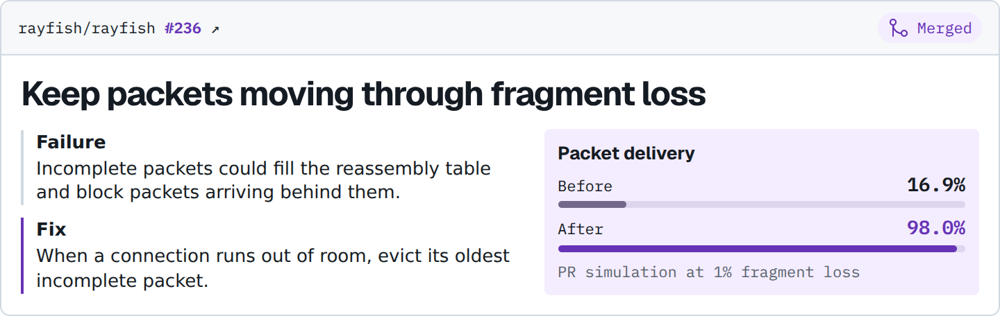

# What I changed upstream

Vignesh Chaturvedi · [@vitwts](https://x.com/vitwts)

<a href="https://github.com/rayfish/rayfish/pull/236">
  <picture>
    <source media="(max-width: 600px) and (prefers-color-scheme: dark)" srcset="./assets/rayfish-patch-mobile-dark.png">
    <source media="(max-width: 600px)" srcset="./assets/rayfish-patch-mobile-light.png">
    <source media="(prefers-color-scheme: dark)" srcset="./assets/rayfish-patch-dark.png">
    
  </picture>
</a>

Rayfish #236 in detail

**Failure.** Incomplete packets could fill the reassembly table and block later packets.

**Fix.** When the reassembly budget fills up, evict the oldest incomplete packet from the same connection to make room for a new one.

**Result.** At 1% fragment loss in the PR's simulation, packet delivery rose from 16.9% to 98.0%. [Read the merged PR and test results](https://github.com/rayfish/rayfish/pull/236).

## More merged fixes

| Pull request | What changed |
| --- | --- |
| [Agave #16695](https://github.com/anza-xyz/agave/pull/16695) | Fixed argument handling so the ledger tool could run programs again. |
| [Supabase #1623](https://github.com/supabase/storage/pull/1623) | Added pagination and continuation tokens to S3 bucket listings. |
